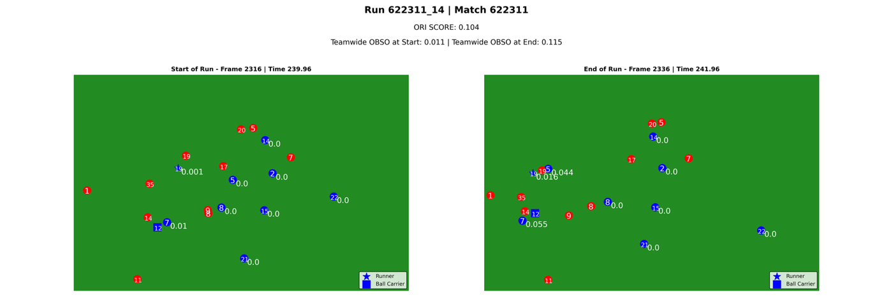
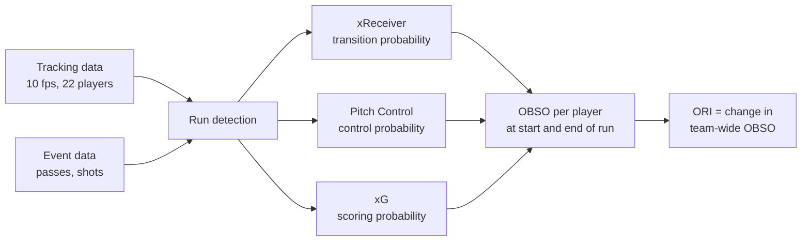
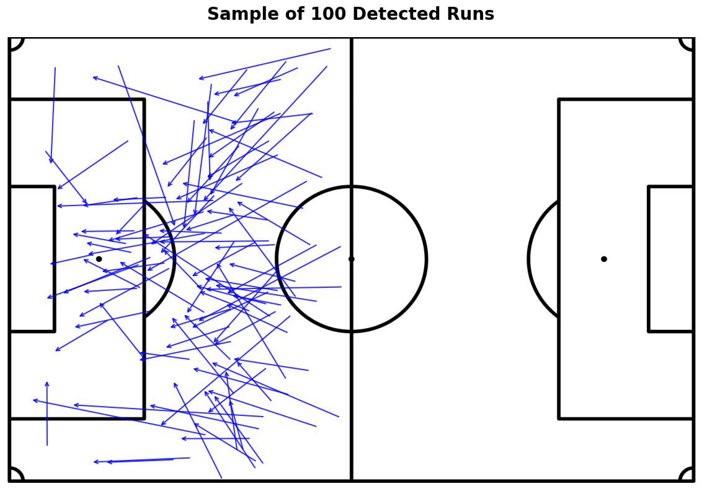
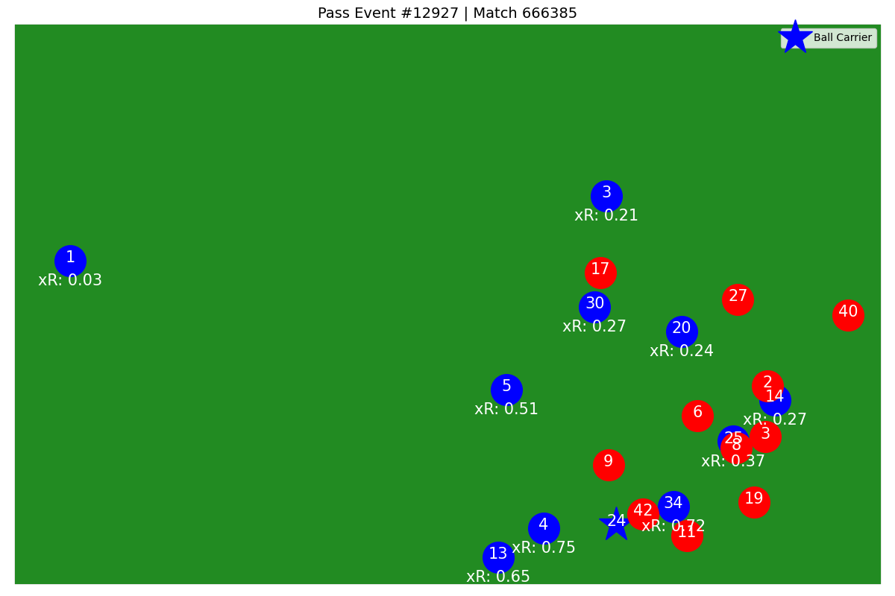
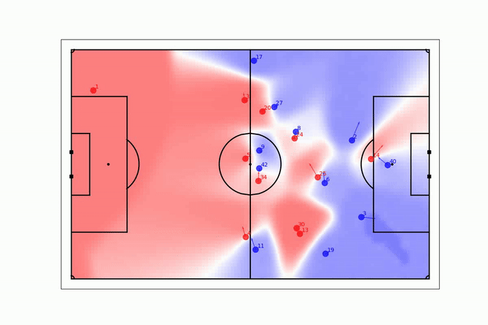
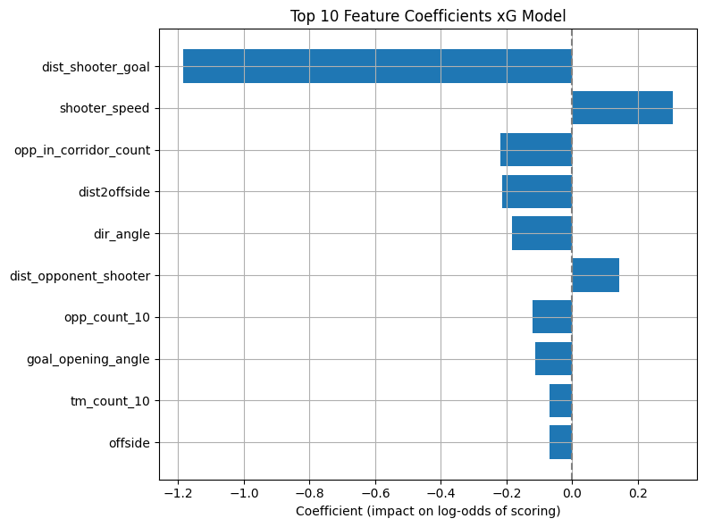
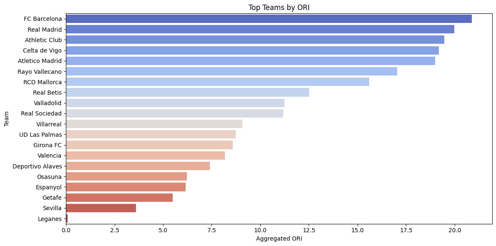

# Off-Ball Run Impact (ORI)

**A metric that measures how much a football player's run without the ball changes their team's chance of scoring.**

A player has the ball for about 3 of the 90 minutes in a match, yet most stats only count what happens on the ball. ORI scores the other 87 minutes: for every attacking run, it compares the whole team's scoring opportunity at the start and at the end of the run.



*Each number is a player's off-ball scoring opportunity (OBSO). This run raised the team total from 0.011 to 0.115, an ORI of +0.104. The runner (#19) and an overlapping teammate (#7) both gained, which pulled the two central defenders together.*

This is the code for my Bachelor's thesis in Data & Business Analytics at IE University (May 2025, supervised by Dae Jin Lee), *Quantifying Off-ball Runs in Football Using Machine Learning and Tracking Data*.

## Key results

| | |
|---|---|
| Matches | 450 from Europe's top 5 leagues, 2024/25 season |
| Off-ball runs scored | 13,169 attacking runs in 250 La Liga matches |
| Strongest link to existing metrics | Goals + assists (r = 0.60) and xG (r = 0.56) |
| Top players by total ORI | Iñaki Williams, Robert Lewandowski, Raphinha |

## How ORI works

ORI builds on William Spearman's **Off-Ball Scoring Opportunity (OBSO)** framework (2018). OBSO estimates, for any player without the ball, the probability that they score from the current game state. It is the product of three probabilities:

$$
\text{OBSO} = P(\text{transition}) \times P(\text{control}) \times P(\text{score})
$$

1. **Transition:** will the next pass go to this player?
2. **Control:** if it does, will they control the ball before a defender?
3. **Score:** if they control it there, will they score?

Measuring only the runner's own OBSO misses decoy runs: a striker who drags two defenders away may lower their own chance while opening space for a teammate. So ORI sums OBSO over **every attacking player** and takes the change across the run:

$$
\text{ORI} = \sum_{i \in \text{team}} \text{OBSO}_i^{\text{end}} - \sum_{i \in \text{team}} \text{OBSO}_i^{\text{start}}
$$

A positive ORI means the run raised the team's scoring chance; a negative one means it reduced it, for example by moving into a crowded area.



## Data

Tracking data (x, y coordinates of all 22 players at 10 frames per second) was synchronised with event data from Wyscout into one record per frame.

| League (2024/25) | Matches | Purpose |
|---|---|---|
| Premier League, Bundesliga, Serie A, Ligue 1 | 50 each | Model development and validation |
| La Liga | 250 | Final testing and ORI evaluation |

The xG model needed more shots than these matches contain, so it was trained on 12,228 shots from 514 matches, adding 294 matches from six other European leagues.

> The tracking and event data is proprietary and is **not included** in this repository. See [Running the code](#running-the-code).

## Pipeline

### 1. Run detection

A run starts when a player reaches at least **5 m/s** with acceleration of at least **2.5 m/s²**, a definition adapted from FC Barcelona's research. It ends when speed drops to 4 m/s or below, acceleration falls below −2.5 m/s², or the team loses possession.

Runs were then filtered to keep only meaningful attacking runs:

- Duration between 1.5 and 20 seconds, which removes tracking glitches.
- A clear team in possession and ball carrier.
- Off the ball at the start (a run that ends with the runner receiving the ball is kept).
- Starts in the attacking half, ends in the final third, and moves at least 10% closer to goal.

The average run covers 15.6 m in 2.8 seconds. Raphinha, Iñaki Williams and Kylian Mbappé made the most runs, which matches how they play.



### 2. Transition probability: xReceiver model

An **XGBoost classifier** predicts which of the 10 teammates receives a pass, using the positions, speeds, angles, nearby opponents, passing-lane congestion and offside line at the moment of the pass.

- Trained on 1.71M rows from 171,285 passes, 90% of them negative. Negatives were downsampled to 3 per pass, with class weighting.
- Evaluated with Top-K accuracy on a test set that was not downsampled, because several receivers are usually realistic: **Top-3 accuracy 55%, Top-5 accuracy 71%**.



### 3. Control probability: Pitch Control

The control probability comes from the physics-based **Pitch Control** model (Spearman, 2018), using Laurie Shaw's open-source implementation from [Friends of Tracking](https://github.com/Friends-of-Tracking-Data-FoTD/LaurieOnTracking). It estimates which team would reach the ball first at every point on the pitch, from each player's position and velocity (max speed 5 m/s, reaction time 0.7 s, arrival-time uncertainty 0.45 s).



### 4. Scoring probability: xG model

A **logistic regression** with L2 regularisation estimates the probability that a shot from a location becomes a goal. It uses distance and angle to goal, shooter speed, defenders between shooter and goal, nearby players and offside position. Logistic regression was chosen for interpretability and well-calibrated probabilities, which matter because ORI sums many small probabilities across the team.

| Metric | Value |
|---|---|
| ROC-AUC | 0.78 |
| Brier score after calibration | 0.074 |
| Mean absolute error vs Wyscout's xG | 0.079 |
| Correlation with Wyscout's xG | 0.55 |

The largest coefficients are distance to goal, shooter speed and opponents in the shooting corridor, which matches football intuition.



### 5. OBSO and ORI

The three probabilities are combined into OBSO for every attacking player at the first and last frame of each run, and ORI is the change in the team total.

## Results

**The components measure different things.** The changes in transition, control and scoring probability are almost uncorrelated with each other (|r| ≤ 0.08), so each adds separate information. ORI is driven mostly by the change in scoring probability (r = 0.78).

**Top players by total ORI (La Liga 2024/25 test set)**

| Player | Team | Total ORI |
|---|---|---|
| Iñaki Williams | Athletic Club | 5.97 |
| Robert Lewandowski | FC Barcelona | 5.44 |
| Raphinha | FC Barcelona | 4.75 |
| Antoine Griezmann | Atlético Madrid | 3.98 |
| Nico Williams | Athletic Club | 3.97 |
| Julián Álvarez | Atlético Madrid | 3.96 |
| Kylian Mbappé | Real Madrid | 3.92 |
| Álex Berenguer | Athletic Club | 3.88 |
| Kike García | Deportivo Alavés | 3.47 |
| Hugo Duro | Valencia | 3.42 |

**Efficiency matters, not just volume.** Players with more runs generally build more ORI, but some get there faster: Luis Pérez and Pep Chavarría reached about 3.1 with roughly 60 runs, while Lamine Yamal and Jude Bellingham needed about 20 more runs for a similar total.

**ORI agrees with established attacking metrics** without being a copy of them:

| Metric | Correlation with ORI |
|---|---|
| Goals + assists | 0.60 |
| xG | 0.56 |
| Goals | 0.51 |
| Assists | 0.47 |
| xThreat | 0.35 |

At team level, FC Barcelona and Real Madrid lead in off-ball scoring opportunities created.



## Limitations

- **Inherited model error.** ORI is only as good as its three sub-models. For example, the xG model slightly overestimates long-range chances, which can inflate ORI for runs that end far from goal.
- **Data quality.** Missing frames, coordinate noise or misaligned tracking and event data affect the result directly.
- **No game context.** The same run is valued equally on a counter-attack and against a low block, and match state and formation are not taken into account.

Possible next steps include adding game context, testing whether ORI predicts future performance, and validating it on other leagues.

## Repository structure

```
Off-Ball-Run-Impact/
├── obso/                   # Run detection, OBSO and ORI calculation
│   ├── obso_main.py        # Main pipeline: detect runs, add xR, PC and xG, compute ORI
│   ├── run_detection/      # Run detection rules, possession and ball-carrier tracking, run plots
│   ├── recalc_xg.py        # Recompute xG for runs after retraining the xG model
│   ├── calc_obso.ipynb     # OBSO calculation walkthrough
│   ├── ori_calc.ipynb      # ORI aggregation per player and team
│   └── obso_eda*.ipynb     # Analysis of runs, components and results (thesis figures)
├── xReceiver/              # Transition probability model
│   ├── xR_get_features_v2.py
│   ├── xgboost_model.py    # Loads the trained model and scores receivers during a run
│   └── x_Receiver_Training.ipynb
├── pitch_control/          # Control probability (Pitch Control)
│   ├── pitch_control.py    # Computes pitch control for every frame of a match
│   ├── metrica_pitch_control.py   # Adapted from Laurie Shaw's implementation
│   ├── format_tracking.py, format_events.py
│   └── run_matches_parallel.py    # Batch processing over many matches
├── xG/                     # Scoring probability model
│   ├── xG_get_data.py      # Shot feature extraction
│   ├── xG_model.py
│   └── xG_training_v2.ipynb
├── docs/                   # Figures and media used in this README
├── ori_config.py           # Paths, configurable with environment variables
└── requirements.txt
```

## Running the code

This is research code from the thesis, published so the method can be read and reused. It **cannot be run end to end as is**, because the tracking and event data, and the scripts that download it from storage, belong to the data provider.

To adapt it to your own tracking data:

1. Install dependencies with `pip install -r requirements.txt` (Python 3.8+).
2. Set the paths in [`ori_config.py`](ori_config.py), or with environment variables such as `ORI_OUTPUTS_DIR` and `ORI_MATCH_LISTS_DIR`. The scripts expect one folder per match containing synchronised tracking and event files (`merged_tracking_events.jsonl`, `events.json`, possession intervals and player lookups).
3. Run the steps in order:
   1. `python pitch_control/pitch_control.py <match_id>` computes the pitch control grids for a match (`run_matches_parallel.py` runs it over many matches).
   2. `xReceiver/x_Receiver_Training.ipynb` and `xG/xG_training_v2.ipynb` train the two models.
   3. `obso/obso_main.py` detects runs, scores each one with all three models and computes ORI.
   4. `obso/ori_calc.ipynb` aggregates ORI by player and team.

The open [Metrica Sports sample data](https://github.com/metrica-sports/sample-data) has a similar structure and is a good starting point for a public-data version.

## References

- Spearman, W. (2018). *Beyond Expected Goals.* MIT Sloan Sports Analytics Conference.
- Spearman, W. et al. (2017). *Physics-Based Modeling of Pass Probabilities in Soccer.* MIT Sloan Sports Analytics Conference.
- Fernández, J., Bornn, L., & Cervone, D. (2019). *Decomposing the Immeasurable Sport: A Deep Learning Expected Possession Value Framework for Soccer.* MIT Sloan Sports Analytics Conference.
- FC Barcelona (2020). *Ready Player Run: Assessing the Value of Off-Ball Movement in Football.*
- Shaw, L. (2020). [LaurieOnTracking](https://github.com/Friends-of-Tracking-Data-FoTD/LaurieOnTracking), Friends of Tracking.

## Author

**Sebastian Vasquez**, data scientist and engineer. [LinkedIn](https://www.linkedin.com/in/sebastianvasquez2002/)
